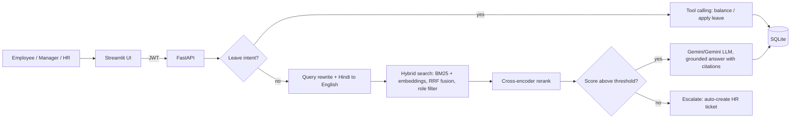

# HR Policy Assistant: production-style RAG system

An HR chatbot for employees that answers policy questions with **verifiable citations**, understands **Hindi / Hinglish**, accepts **voice**, enforces **role-based document access**, and can **check leave balance and apply for leave** through LLM tool calling. HR gets an admin panel with analytics and document upload.

## Architecture


## Features
| Area | Feature |
|---|---|
| Retrieval | Hybrid search (BM25 + multilingual embeddings) with Reciprocal Rank Fusion, then cross-encoder reranking |
| Trust | Citations with document, section, page and the **highlighted supporting sentence**; "not found" guardrail that auto-escalates to an HR ticket |
| Access control | JWT login; Employee / Manager / HR roles; restricted documents are filtered **inside the vector and BM25 search**, so they can never be retrieved by lower roles |
| Agent | Tool calling for "how many casual leaves do I have left?" and "apply sick leave 3 to 4 Dec"; policy rules enforced in code (3-day casual limit, 7-day earned notice, balance check); manager/HR approval flow |
| Languages | English, Hindi, Hinglish (query translation + same-language answers) |
| Voice | Speech-to-text (Gemini audio input or Groq Whisper) and text-to-speech (gTTS) |
| Admin | Upload PDFs with a visibility role (auto re-index), analytics (top questions, escalation rate, helpful rate, latency), weak-answer review from 👎 feedback, ticket resolution |
| Engineering | FastAPI + Streamlit, SQLite chat history and feedback, unit tests, evaluation harness, Docker and Render blueprint |

## Quick start
```bash
python -m venv venv && venv\Scripts\activate      # Mac/Linux: source venv/bin/activate
pip install -r requirements.txt
copy .env.example .env                            # add GEMINI_API_KEY (free at aistudio.google.com/apikey) and SECRET_KEY
python -m app.rag.indexer                         # build the index (downloads models on first run)
uvicorn app.api:app --reload                      # API + docs at http://localhost:8000/docs
streamlit run ui/streamlit_app.py                 # UI at http://localhost:8501
```
Or with Docker: `docker compose up --build`.

**Demo accounts** (change before any real use): `employee / emp123`, `manager / mgr123`, `hr / hr123`.
Try: "How many casual leaves do I have left?", "Notice period kitna hai?", then sign in as HR and ask "What is the salary band for L2?" (employee gets escalated, HR gets the answer).

## LLM provider
Default is the free **Google Gemini API** (`LLM_PROVIDER=gemini`, key from Google AI Studio). Set `LLM_PROVIDER=groq` and `GROQ_API_KEY` to use Groq instead. Both are called through the OpenAI-compatible API, so the same code handles chat and tool calling. Free-tier model names and rate limits change; if you get a 404 or 429, check Google AI Studio and set `LLM_MODEL`.

## Evaluation
`eval/eval_set.json` has 35 questions: policy questions across all documents, Hinglish/Hindi, role-restricted, and out-of-scope.
```bash
python eval/run_eval.py --retrieval-only   # free, no LLM key
python eval/run_eval.py                    # full pipeline incl. answer keyword accuracy
```
Metrics: Hit@k, MRR, refusal rate on out-of-scope/restricted questions, keyword accuracy, latency. Output goes to `eval/results.md`. **Run it and paste your own numbers here:**

| Metric | Result |
|---|---|
| Hit@k | _run eval_ |
| MRR | _run eval_ |
| Refusal rate | _run eval_ |
| Answer keyword accuracy | _run eval_ |

## Tests
`python -m unittest discover -s tests` covers security (hashing, JWT), chunking, RRF, citation highlighting, access levels, leave rules and analytics.

## Project structure
```
app/            config, db, security, api.py (FastAPI), voice.py
app/rag/        indexer, retriever (hybrid + rerank), generator (LLM), pipeline, citations, textutils
app/agent/      tools.py (leave rules + tool calling)
ui/             streamlit_app.py
data/           policies/ (fictional company documents), access.json (who can see what)
eval/           eval_set.json, run_eval.py
tests/          unit tests
```

## Deploy
Render: push to GitHub, create a Blueprint from `render.yaml`, set `GEMINI_API_KEY`, then set `API_URL` on the UI service to the API's public URL. The embedding and reranker models need roughly 1 GB RAM, so use a paid instance or a Hugging Face Space.

## Limitations (be upfront in interviews)
- Demo auth with seeded users and SQLite; production would use SSO and Postgres.
- Policies are fictional; real documents would need PDF layout checks.
- Keyword accuracy is a proxy metric; for deeper evaluation add LLM-as-judge or human review.

## Resume bullets
- Built an HR policy RAG assistant (FastAPI, ChromaDB, BM25, cross-encoder reranking, Gemini LLM) with role-based document access, cited answers and automatic HR escalation.
- Implemented LLM tool calling for leave balance and leave requests with policy rules enforced in code, plus a manager approval workflow.
- Added Hindi/Hinglish and voice support; built an evaluation harness over 35 questions (Hit@k **[X]%**, refusal rate **[Y]%**) and unit tests; containerized with Docker.
